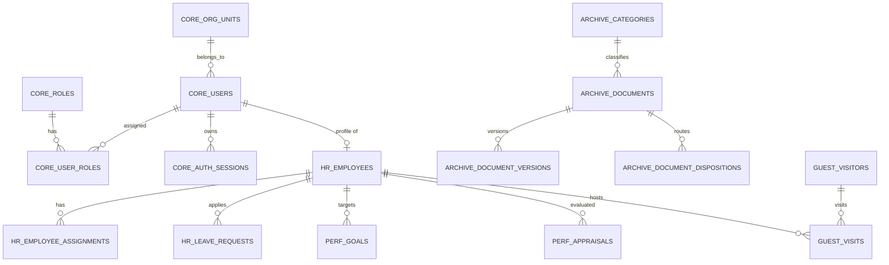

# Rancangan ERD dan Konvensi Data

Status: VALID rancangan data acuan. Sumber kebenaran skema database SQL ada di `db/schema.sql` dan berkas migrasi `db/migrations/`.

## 1. Konvensi Data

1. **Identifier dalam Bahasa Inggris**: Nama tabel, kolom, enum, dan index menggunakan bahasa Inggris (`users`, `employees`, `employee_assignments`). Kamus istilah padanan Indonesia tercantum di bagian 3.
2. **Multi-Skema PostgreSQL**:
   - `core` : identitas pengguna, unit organisasi, RBAC, sesi, MFA, file, penomoran
   - `hr` : data kepegawaian, jabatan, keluarga, pendidikan, cuti/izin
   - `perf` : siklus kinerja, sasaran (SKP/OKRs), progres, penilaian, aspek perilaku
   - `archive` : klasifikasi arsip, naskah dinas, disposisi, retensi, pemusnahan
   - `guest` : data pengunjung, janji temu, log kunjungan fisik, lencana/pendamping
   - `audit` : log jejak audit append-only dengan rantai hash sha256
3. **Kolom Standar (`core.base_columns`)**:
   Setiap tabel bisnis menyalin kolom:
   - `created_at timestamptz NOT NULL DEFAULT now()`
   - `updated_at timestamptz NOT NULL DEFAULT now()`
   - `created_by uuid` (tanpa FK langsung demi mencegah siklus; dicatat & diaudit)
   - `updated_by uuid`
   - `deleted_at timestamptz` (soft delete)
   - `row_version integer NOT NULL DEFAULT 1` (optimistic locking)
4. **Perlindungan Data Sensitif**:
   - Kolom sensitif (NIK, identitas tamu, telepon, email tamu, MFA secret) disimpan terenkripsi dengan akhiran `_enc` (AES-256-GCM).
   - Kolom pencarian/deduplikasi eksak menggunakan blind index dengan akhiran `_hash` (`HMAC-SHA256`).

## 2. Struktur Modul & Skema

## 3. Kamus Istilah

| Istilah Indonesia      | Nama Kolom / Entitas            | Penjelasan                                                      |
| ---------------------- | ------------------------------- | --------------------------------------------------------------- |
| Unit Organisasi        | `core.org_units`                | Satuan kerja dalam struktur hierarki organisasi (`ltree`)       |
| Pengguna & Akun        | `core.users`                    | Kredensial login pengguna dengan hash Argon2id                  |
| Hak Akses / Izin       | `core.permissions`              | Daftar izin sistem berformat `<modul>.<resource>.<aksi>`        |
| Peran Pengguna         | `core.roles`                    | Peran pengguna bawaan dan custom organisasi                     |
| Sesi Login             | `core.auth_sessions`            | Sesi aktif dan pelacakan family token rotasi                    |
| Berkas / File          | `core.files`                    | Metadata berkas terpusat dan status pemindaian virus            |
| Pegawai                | `hr.employees`                  | Biodata pegawai dan nomor identitas terenkripsi                 |
| Riwayat Penempatan     | `hr.employee_assignments`       | Penempatan jabatan pegawai (exclusion constraint non-overlap)   |
| Permohonan Cuti        | `hr.leave_requests`             | Pengajuan dan persetujuan ketidakhadiran resmi                  |
| Saldo Cuti             | `hr.leave_balances`             | Kuota cuti tahunan dan akumulasi penggunaan                     |
| Sasaran Kerja / SKP    | `perf.goals`                    | Target capaian kinerja individu dalam periode evaluasi          |
| Penilaian Kinerja      | `perf.appraisals`               | Lembar evaluasi capaian kinerja berkala                         |
| Aspek Perilaku         | `perf.behavior_aspects`         | Indikator penilaian perilaku kerja pegawai                      |
| Naskah Dinas / Dokumen | `archive.documents`             | Surat masuk, keluar, atau naskah dinas resmi (`search_vector`)  |
| Versi Dokumen          | `archive.document_versions`     | Riwayat berkas versi revisi dokumen (deferred FK)               |
| Disposisi Naskah       | `archive.document_dispositions` | Instruksi tindak lanjut pimpinan terhadap naskah dinas          |
| Buku Tamu / Kunjungan  | `guest.visits`                  | Log kehadiran fisik pengunjung ke kantor organisasi             |
| Pengunjung             | `guest.visitors`                | Master pengunjung dengan nomor identitas terenkripsi            |
| Janji Temu Tamu        | `guest.appointments`            | Pra-registrasi dan jadwal kunjungan tamu                        |
| Jejak Audit            | `audit.audit_logs`              | Catatan transaksi append-only dengan rantai hash tamper-evident |

## 4. Aturan Perubahan Skema

- Tidak pernah mengubah migrasi yang sudah dirilis.
- Setiap migrasi baru wajib memperbarui dokumen ini dan berkas snapshot acuan `db/schema.sql`.
